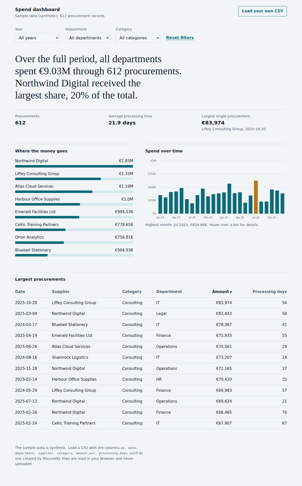

# Spend Dashboard

[](https://github.com/jullianysantosbarbosa-code/spend-dashboard/actions/workflows/ci.yml)


**Live demo:** https://jullianysantosbarbosa-code.github.io/spend-dashboard/

An interactive dashboard for exploring procurement spend: where the money goes, how it changes over time, and which purchases are the largest. It runs entirely in the browser with plain HTML, CSS and JavaScript. There is no framework, no build step and no server.



I built it as the visual companion to [ProcureIQ](https://github.com/jullianysantosbarbosa-code/procureiq), my command-line analytics tool. It draws on my experience in public procurement, where the people who need the numbers are often not analysts. That is why the page opens with a sentence in plain language instead of a wall of charts. **All sample data is synthetic.**

## Features

- **Plain-language summary** that rewrites itself as you filter, for example: *In 2025, the Legal department spent €851.84K through 54 procurements. Northwind Digital received the largest share, 31% of the total.*
- **Filters** by year, department and category, applied to every section at once.
- **Spend by supplier**: the eight largest suppliers with their share of spend.
- **Spend over time**: a monthly column chart drawn as SVG, with empty months filled in and the peak month highlighted.
- **Sortable table** of the largest procurements.
- **Bring your own data**: load any CSV in the format below. The file is read in your browser and never uploaded. Errors name the exact row, for example `Row 3: supplier must not be empty.`
- **Light and dark themes** that follow your system setting.
- **Zero dependencies**: charts are hand-built with SVG and HTML, with no charting library.

## Run it

No installation is needed. Open `index.html` in a browser, or serve the folder:

```bash
git clone https://github.com/jullianysantosbarbosa-code/spend-dashboard.git
cd spend-dashboard
npm start        # serves http://localhost:8000 (requires Python 3)
```

To publish it, enable **GitHub Pages** (Settings, then Pages, then deploy from the `main` branch, root folder).

## CSV format

```text
id,date,department,supplier,category,amount_eur,processing_days
1,2024-01-01,IT,Liffey Consulting Group,Office Supplies,175.96,7
```

Columns can be in any order. Dates must be real dates in `YYYY-MM-DD` format, and amounts and processing days must be numbers of zero or more. Quoted fields, commas inside quotes, Windows line endings and a byte order mark are all handled. Files created by ProcureIQ (`procureiq generate`) work as they are.

## Accessibility

- Semantic structure: one `h1`, a heading for every section, a real `table` with column headers and `aria-sort` on the sorted column.
- Every control has a visible label, and keyboard focus is always visible.
- Charts have text equivalents: each supplier bar has an `aria-label` with its share, and the monthly chart has a written description of its range and highest month.
- Upload errors are announced to screen readers (`role="alert"`) and the headline updates politely (`aria-live`).
- Colour contrast was chosen for both themes, the page works at 390 px wide without sideways scrolling, and there are no animations.

## Project structure

```text
spend-dashboard/
├── index.html
├── css/styles.css        # design tokens, layout, light and dark themes
├── js/
│   ├── analytics.js      # pure functions: parsing, filtering, summaries (unit tested)
│   └── app.js            # DOM and SVG rendering
├── data/sample-data.js   # synthetic dataset (same format as ProcureIQ output)
├── test/analytics.test.js
└── .github/workflows/ci.yml
```

## Testing

```bash
npm test
```

`analytics.js` has no access to the page, so all of the logic is tested in Node with the built-in test runner (21 tests): CSV parsing edge cases, row-level validation messages, filters, supplier shares, month gap filling across a year boundary, sorting stability, currency formatting and the generated sentences. GitHub Actions runs the suite on Node 20 and 22.

## Design decisions

- **Logic and display are separate.** `analytics.js` works in both Node and the browser, so the rules that matter are testable without a browser.
- **The headline is a sentence, not a big number.** A sentence states the finding and who benefits; the supporting facts sit underneath.
- **HTML for bars, SVG for the time series.** Supplier bars are HTML elements, which keeps them accessible and responsive for free. The monthly chart needs axes, so it is SVG.
- **Data is embedded as CSV text**, parsed by the same code that reads uploaded files. The page works when opened straight from disk, and the sample exercises the real parser.

## Roadmap

- Export the current selection as CSV.
- Compare two periods side by side.
- Mark possible split purchases and unusual amounts, using the rules from ProcureIQ.

## Author

Julliany Barbosa · [LinkedIn](https://www.linkedin.com/in/julliany-santos-barbosa) · [GitHub](https://github.com/jullianysantosbarbosa-code)

Released under the [MIT License](LICENSE).
